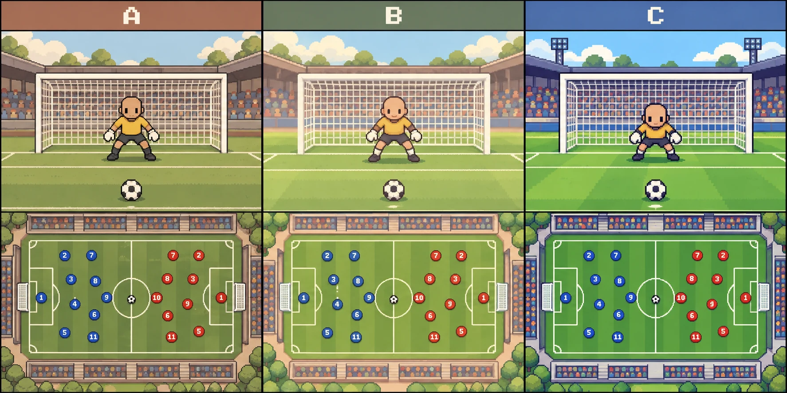

# 경기·승부차기 화풍 — B 확정

2026-10-13 사용자 선택: 비교 시안의 **B(가운데)**.

- 기준: 기존 구단 사무실·버스 배경의 부드럽고 따뜻한 도트와 프로필 캐릭터의 단순한 표현. 파스텔 하늘, 세이지·연두 잔디, 크림색 경기장 선, 낮은 대비의 윤곽, 큰 색 면과 2~3단계 명암을 쓴다.
- PK: 둥근 머리, 작은 눈·입, 짧은 팔다리의 귀여운 골키퍼. 근육·피부·얼굴의 사실적 묘사와 촘촘한 옷 주름을 넣지 않는다. 경기장·관중·잔디도 간결하게 표현한다. 포즈를 바꿔도 같은 얼굴과 캐릭터 크기를 유지한다.
- 본경기: 사람 스프라이트 대신 유니폼색의 **둥근 바둑알 + 등번호**로 두 팀을 표시한다. 약한 하이라이트·얇은 그림자만 쓰며 광택이 강한 3D 구체로 만들지 않는다. 내 선수는 금색 테두리와 이름으로 구분한다.
- 피할 것: 사실적인 얼굴·근육·날카로운 명암, 거친 잔디·관중 노이즈, 불쾌한 골짜기 느낌의 스포츠 일러스트.
- 움직임은 아래 골 하이라이트 기준을 따른다. 선수가 공을 받을 위치로 먼저 이동하며, 역할과 공격 상황에 맞춰 경로를 나눈다.

현재 자산은 `public/img/career-match/pitch.webp`와 `public/img/career-penalty/`에 있다. 같은 파일을 바꾼 호출 주소에는 `?v=2`를 사용한다.

생성 원본: `exec-e06243c9-44c5-4025-ba8c-d15e9dbac3b1.png`(PK 배경), `exec-09c3109e-d7b8-406d-af83-492646df61e3.png`(본경기 배경), `exec-06d428d3-2412-432f-aae2-e5461dc6324d.png`(골키퍼). 원본은 `/workspace/generated_images/`에 보존한다.

## 대회 오버레이 배경

사용자 지정: 본경기·PK 자산을 야간으로 바꾸는 대신 화면 전체 뒤에 깔리는 대회 배경을 B에 맞춘다. `public/img/career-scenes/international-stadiums.webp`의 4열×2행 순서와 대회별 풍경은 유지하고 파스텔 낮 하늘·크림색 구조물·세이지 잔디로 다시 제작했다. 본경기와 PK의 기존 B 그림은 유지한다. 오버레이 배경 호출은 `?v=2`다. 생성 원본은 `/workspace/generated_images/exec-27db2ef4-376e-4a6e-9b55-cf217fed35d0.png`.

## 골 하이라이트 움직임 개선

골·실점 장면만 재생한다. 기본 13종에 풀백 연계·하프스페이스 침투를 추가해 반대편 긴 크로스 수신·안쪽 돌파를 더해 세트피스 세컨볼 득점까지 시퀀스는 총 16종이다. 0:0 경기는 장면을 억지로 만들지 않고 종료 기록/승부차기로 진행한다. 각 골은 전개·침투·마무리로 구성하고, 이동 거리에 따른 선수·공의 속도 제한을 적용해 재생 시간을 정한다. 서로 다른 시간의 장면 사이에는 짧은 전환을 넣는다. 풀백 오버래핑·반대 풀백 중앙 지원, 윙어 연계, 수비 압박·커버·러너 추적을 개별 경로로 표현한다. 공 전달 시점과 선수 수신 위치를 맞추며 공중 크로스에는 높이·그림자·낙하지점을 표시한다. 실제 경기 AI가 아닌 확정된 결과를 보여주는 연출이다.

- 수신 지점마다 전체 선수가 감속하던 문제 수정: 좌표마다 속도가 이어지는 보간을 사용한다. 실제 방향 전환·정지에서만 해당 축을 감속한다. 패스 도착 시 수신자의 이동과 주변 선수들의 달리기가 지속되며, 경로가 제어점 밖으로 튀지 않도록 제한한다.

- 골 패턴은 같은 패스 세 번을 반복하지 않는다. 원투는 되돌려주기와 재침투, 스루패스는 이른 뒷공간 전달 후 드리블, 역습은 두 번의 빠른 전진 패스 후 긴 운반, 크로스는 측면 오버래핑 후 공중 전달, 컷백은 골라인에서 뒤로 내주는 전달로 구분한다. 모든 종류를 섞어 뽑으며 한 묶음 안에서 중복하지 않고 묶음 경계에서도 같은 패턴이 연속되지 않도록 한다. 목업에는 개별 패턴 비교 선택을 둔다.

- 골 패턴 4종 추가(총 9종): 박스 밖 중거리 슛, 반대편으로 긴 공중 전환 후 크로스, 땅볼 크로스에 달려드는 마무리, 코너킥 점프 헤더. 헤더는 선수 점프와 공 높이를 함께 표현하고 그림자는 잔디에 남긴다. 모든 장면은 실제 확정된 골·도움 주인공을 유지한다.

- 추가 4종(총 13종): 수비 앞에서 방향을 바꾸는 드리블 돌파, 전진한 골키퍼를 넘기는 칩슛, 점프하는 수비벽을 넘기는 프리킥 감아차기, 짧은 코너킥에서 재차 올리는 크로스·헤더. 도움 기록이 있는 프리킥은 짧게 내준 공을 마무리하는 루틴으로 재생해 실제 기록을 유지한다.

## 선수 카드·주발에 따른 하이라이트

플레이어의 `pos`, `card`, `foot`를 경기 렌더러로 전달한다. 윙어는 정발, 인사이드 포워드는 역발 측면에 배치하고 풀백·윙백·인버티드 풀백은 정발 측면의 수비 슬롯을 사용한다. 좌우는 우리 팀 공격 방향을 기준으로 하며 후반에는 양 팀의 위치를 180도 전환한다. 수비형 미드필더·딥라잉 플레이메이커는 포백 앞, 공격형 미드필더는 전방, 메짤라는 하프스페이스를 사용한다. 양발은 기본 오른쪽(인사이드 포워드는 왼쪽)으로 배치한다. 득점·도움 장면은 같은 바둑알이 해당 플레이를 수행하며 세트피스에서는 키커 위치로 이동한다. 비기여 장면에서 내 바둑알이 동료의 골·최종 도움을 대신하지 않게 한다. 목업에서 역할과 주발을 선택해 확인할 수 있다.

- 수비 포지션은 처음부터 가능한 득점 시퀀스를 선택한다. 기존 중앙 공격수 경로에 좌표를 덧씌우거나 모든 패턴을 수비 선수에게 맞추지 않는다. 풀백·윙백은 연계 후 하프스페이스 침투 60%, 중거리 15%, 반대편 긴 크로스 수신 후 안쪽 돌파 15%, 세컨볼 10%; 인버티드 풀백은 하프스페이스 침투 70%, 중거리 20%, 세컨볼 10%; 센터백·볼플레잉 센터백·스위퍼는 코너 헤더 65%, 짧은 코너 헤더 15%, 중거리 5%, 세트피스 세컨볼 15%; 수미·딥라잉 플레이메이커는 중거리 65%, 세트피스 헤더 15%, 세컨볼 20%다. 이는 이미 확정된 골을 보여주는 장면의 선택 비중이며 실제 득점 확률을 바꾸지 않는다. 하프스페이스 장면은 전진한 측면에서 공을 안으로 주고 움직이며 돌려받는다. 중거리는 박스 밖 지원 위치에서 시작한다. 세트피스도 처음부터 해당 위치에서 시작하며 갑자기 수비 위치에서 달려오지 않는다. 도움은 기본 역할의 지원 경로를 유지한다. 목업에서 역할에 맞지 않는 득점 패턴은 비활성화한다.

- 반대편에서 길게 넘어온 크로스를 받아 안쪽으로 치고 들어온 후 슛하는 장면은 풀백·윙백·윙어·인사이드 포워드의 득점에 사용한다. 원래 측면에서 움직이며 공을 받고, 지상 컨트롤·대각선 운반 구간을 거쳐 마무리한다. 센터백·수미 등에는 이 패턴을 선택하지 않는다.

- 세트피스 세컨볼: 모두 이미 전진한 상황에서 크로스 → 골문 앞에서 막힘 → 튕겨 나오는 공 → 슈팅을 표현한다. 수비·수미는 박스 뒤쪽에 남아 세컨볼 슛, 공격진은 골문 앞 혼전 마무리로 나눈다. 도움 기록이 있으면 세컨볼을 회수한 본인이 동료에게 실제 마지막 패스를 하도록 한다. 최초 키커와 세컨볼 회수자는 다른 선수일 수 있으며 후방 선수가 갑자기 코너 키커 위치로 이동하지 않는다.

- 세트피스 대형은 인플레이 대형을 사용하지 않는다. 코너·짧은 코너·세컨볼에서는 박스 안 공격·마크 인원, 박스 뒤 대기 인원, 역습을 대비해 남는 두 명을 분리한다. 프리킥은 별도 수비벽과 박스 인원을 사용한다. 양 팀 골키퍼는 필드 유니폼 및 상대 골키퍼와 색이 구분되는 별도 팔레트에서 자동 선택한다.

## 전체 움직임 재점검

선수의 역할 좌표와 득점자 좌표를 장면 중간에 섞던 보정을 제거했다. 실제 공 전개에 참여하는 선수는 처음부터 끝까지 해당 장면의 한 경로를 따른다. 낮은 크로스의 서비스 측면과 받는 선수의 측면을 구분하고, 첫 포스트·뒤쪽 포스트·페널티 지점 침투를 나눈다. 중거리 슛은 중앙·좌우 하프스페이스와 거리·패스 방향을 함께 바꾼다. 시드에 따라 연결된 공격 전체의 폭과 깊이가 달라지며 임의로 선수만 흔들지 않는다. 선수 이동은 최대 약 9m/s, 공 이동은 약 38m/s를 기준으로 장면별 재생 길이를 산정한다. 목업의 다른 장면 재생은 새 시드로 다른 전개를 보여준다. 센터백·수미의 도움은 후방에서 가능한 전개로 제한하고 실제 마지막 패스 경로도 후방 지원 위치에서 시작한다.

- 코너·짧은 코너의 헤더는 첫 포스트·뒤쪽 포스트·중앙 침투로 다양화한다. 프리킥의 볼 위치가 바뀌면 수비벽도 골문과 볼 사이의 위치로 함께 이동한다.

- 공의 소유 위치는 고정 공격 방향이 아니라 선수 경로의 연속적인 이동 방향을 따른다. 짧은 구간의 이동 벡터와 정지 시 다음 패스 방향을 부드럽게 섞고, 화면상 바둑알 앞쪽 약 19px 지점에 공을 놓는다. 보유·킥 출발·수신 모두 같은 위치 계산을 공유해 공이 튀지 않게 한다. 방향은 8방향으로 나누지 않는다. 기본 재생은 산정된 시간보다 1.25배 빠르게 진행한다.

- 세컨볼 마무리는 네 종류다: 수비·수미의 박스 밖 바로 슈팅 / 컨트롤 후 옆으로 터치하고 슛, 공격진의 골문 앞 원터치 / 혼전 회수 후 짧게 연결하고 마무리. 역할에 맞는 두 종류 중 선택하며 같은 장면을 모두에게 붙이지 않는다. 공을 올린 키커가 불필요하게 멀리 뛰던 동작을 줄이고, 세컨볼 후 마무리 간격을 조정해 기준 장면의 재생을 약 5–6초로 단축했다. 목업에서 세컨볼 방식도 비교할 수 있다.

- 세컨볼 접촉을 명시한다: 박스 뒤 슛은 수비수가 크로스를 헤더로 걷어낸 위치에서 공이 되돌아오고, 골문 앞 슛은 골키퍼 토큰의 접촉 위치에서 선방 뒤 공이 흘러나온다. 접촉 타이밍·위치·점프 높이를 공과 맞추며 별도의 원이나 문구 없이 선수 동작과 공 궤적으로 표현한다. 노마크 세컨볼은 직접 슛하며 짧은 연결 장면은 회수자가 수비에게 압박받고 최종 슈터에게 공간이 열린 대형에서만 사용한다.

- 골키퍼는 슛 반대편으로 피하지 않는다. 실제 슈팅 이후 짧은 반응 지연을 두고 공이 향하는 쪽으로 움직인다. 프리킥·중거리·후방 세컨볼 중거리는 좌측·중앙·우측을 같은 비중으로 노린다. 좌우 슛은 골문 안쪽 여유를 두며 중앙 슛은 골키퍼 위로 들어가는 높이를 가진다. 중앙의 공과 골키퍼 바둑알은 화면상 겹칠 수 있다.

- 수미·딥라잉 플레이메이커의 짧은 코너 헤더는 박스 가장자리 대기 → 크로스 직전 지연 침투로 재생한다. 가까운 포스트·중앙·먼 포스트 경로를 나누며 마커도 뒤따른다. 기본 전개 구간만 추가로 1.25배 빠르게 재생하며 마지막 슈팅·헤더의 비행 시간은 유지한다.

- 센터백·볼플레잉 센터백·스위퍼의 드문 중거리 득점은 지속 공격으로 라인을 올린 대형에서 나온다. 공격진은 박스 주변, 중원은 그 뒤, 센터백은 하프라인 너머 후방 지원 위치를 유지한다. 앞선의 연결 → 뒤로 내주는 패스 → 짧게 전진해 중거리 슛으로 마무리하며 미드필더 전용 출발 위치를 공유하지 않는다.

- 인플레이는 고정 대형의 작은 이동이나 짧은 가속 효과로 만들지 않는다. 볼 운반자가 전진해 압박을 끌어낸 뒤 연결하고, 동료는 전진 경로의 폭과 깊이를 확보하며 침투·후방 지원을 한다. 상대는 공의 전개에 늦게 반응해 압박·커버·복귀하며 패스 속도로 공을 쫓지 않는다. 뒤로 연결돼도 공격진과 수비 라인이 동시에 후퇴하지 않고, 슛 이후에는 필드 선수들이 공을 따라 골문으로 몰리지 않는다.

- 프리킥은 실제 키커의 주발을 따른다. 내 선수의 직접 득점은 캐릭터 주발을 사용하고 동료·상대 키커는 주발을 별도로 정한다. 오른발은 공격 방향 기준 좌측, 왼발은 우측에서 시작하며 인사이드 킥의 회전 방향과 비스듬한 도움닫기를 거울처럼 맞춘다. 목표 지점 때문에 회전 방향이 뒤집히지 않으며 공의 진행 벡터에 수직인 곡선을 써 후반·상대 팀의 반대 방향 공격도 처리한다.

- 프리킥 공은 도움닫기 동안 고정한다. 짧게 내주는 프리킥은 정지된 공을 한 번 굴려 놓고 슈터가 찬다. 감아차기는 얕은 포물선으로 전체 비행 구간에 걸쳐 완만하게 감기며 골문 앞에서 목표를 향해 갑자기 꺾지 않는다.

- 감아차기 도움닫기는 실제 슛의 출발 접선과 주발을 함께 보고 정한다. 오른발은 공의 왼쪽 뒤, 왼발은 오른쪽 뒤에서 사선으로 접근한다. 정지된 공의 접촉 시각에 맞춰 접근하고 같은 방향으로 짧게 후속 동작을 한다. 수비벽은 키커의 대기 위치가 아니라 공의 위치를 기준으로 배치한다.

- 연계·하프스페이스 침투는 윙어가 폭을 유지해 상대 풀백을 묶고, 중앙 공격수가 센터백을 묶어 그 사이를 연다. 득점 선수는 안쪽 연계 후 해당 채널로 언더래핑하며 윙어보다 앞쪽으로 패스를 받아 박스 안쪽 하프스페이스에서 마무리한다. 반대편 윙어도 중앙 원톱 자리로 좁혀 들어가지 않는다. 윙어 본인이 득점하는 경우 같은 측면 풀백이 폭을 제공한다.

- 하프스페이스의 좌우 수비 대형은 시작 프레임뿐 아니라 전체 기준 경로에서 같은 측면을 유지한다. 인사이드 포워드의 좌우 반전에서 반대편으로 뛰는 잘못된 수비 경로가 시간 산정에 들어가 애니메이션 전체를 늘리지 않도록 한다.

- 상대 수비 전방은 중앙 선수와 양쪽 측면 선수가 서로 다른 압박·차단 위치를 맡는다. 중원은 볼 쪽 선수가 압박하고 중앙 선수는 안쪽 패스 길을 막으며 반대편 선수는 커버한다. 내 윙어가 수비하는 장면도 그 주발·포지션에 맞는 측면을 유지하고 다른 윙어는 반대 측면을 맡아 같은 경로로 겹치지 않는다.

- 경기 중계 문구는 화살표로 패턴 절차를 설명하지 않는다. 전개와 득점에 맞는 짧은 현장 중계 문장을 사용하며 내 선수의 득점·도움을 구분하고 상대 득점에도 같은 기준을 적용한다.

- 대표팀 바둑알은 검증한 전체 73개 대표팀의 최신 확인 가능 홈·어웨이 색을 사용한다. 양 팀 홈을 기본으로 하고 색이 겹치면 상대 어웨이를 우선 선택한다. 줄무늬 없이 몸통 대표색의 단색으로 표현하며, 밝은 바둑알의 등번호는 검정, 어두운 바둑알은 흰색을 사용한다. 색상 자료와 규칙은 `national-kits.md`에 정리한다.

## 인터뷰 배경

인터뷰실은 따뜻한 크림색·목재와 차분한 남색의 도트 그림을 사용한다. 상단 스폰서 월과 중립적인 축구 문양, 하단 중앙 마이크, 양쪽 카메라로 인터뷰 분위기를 표현하며 질문·답변은 기존 UI를 유지한다. 답변 카드는 밝은 그림 위에서도 읽히도록 기존 경기 로그의 어두운 패널색을 사용한다. `public/img/career-scenes/interview.webp?v=2`을 `crIvShow()`에서 표시한다.

생성 원본: `/workspace/generated_images/exec-76d6dfb8-6872-40da-b543-84690cd7b0be.png`(보존). 모바일·PC와 답변 선택, 타자 연출 건너뛰기에서 확인했다.

## 이적시장 배경

이적 제안을 고르는 화면은 인터뷰실과 같은 따뜻한 목재·크림색·남색 도트 화풍의 에이전트 사무실을 사용한다. 계약서와 펜, 제안 목록이 표시된 노트북, 유니폼과 경기장 창문으로 협상 분위기를 표현한다. 카드와 기존 선택·계약 흐름은 유지하며, 배경은 장식 이미지로 `crTmShow()`에만 연결한다. 완료 발표 화면은 별도의 `official.webp` 그림과 계약 패널을 사용한다. 긴 제안 목록은 배경 위에서 스크롤된다.

파일: `public/img/career-scenes/transfer.webp?v=2`.
중앙 벽은 밝은 크림색·웜그레이, 의자는 토프색으로 조정해 어두운 반투명 선택 카드와 구분한다. 선택 카드 불투명도는 기존 값을 유지한다.
생성 원본 v1: `/workspace/generated_images/exec-615c5fe6-4efb-4f7d-a356-466e42bc1297.png`(보존).
수정 원본 v2: `/workspace/generated_images/exec-bf484de6-b53a-49c2-8fc9-9ddd928e4042.png`(보존).

## 이벤트 배경 통일 · 2026-10-14

인터뷰실의 중앙 스폰서 벽과 의자는 밝은 크림색·웜그레이·토프로 수정했다. 카드 불투명도는 유지한다. 회색기가 강하던 주장 라커룸·식단·공항·SNS·학업 그림 다섯 장은 이적시장과 같은 따뜻한 목재·크림색 도트 화풍과 모바일 세로 구도로 재제작했다. 원본 경로는 `data/event-backgrounds.json`, 전체 오버레이 배경 유무·유지 판단은 `background-audit.md`에 기록한다. 변경 자산 URL은 `?v=2`로 갱신했다. 기존 인터뷰 v1 원본도 보존한다.

## 프로 라커룸 · 오피셜 발표 수정

라커룸은 철제 닫힌 사물함과 학교형 벤치 대신 둥글게 배치한 열린 선수별 유니폼 공간·쿠션 좌석·축구화 선반·간접 조명을 사용한다. 주장·부주장 공용 `captain.webp?v=3`. 원본: `/workspace/generated_images/exec-6857cb66-42b1-4c4b-98e1-713c113af990.png`.

이적·재계약 완료는 `official.webp?v=1`의 밝은 구단 발표실과 계약 패널을 사용한다. 원본: `/workspace/generated_images/exec-08f68f8f-352e-4b5f-b703-de2d0643ee95.png`. 작은 금색·크림색·세이지색 종잇조각 36개가 양옆에서 시간차를 두고 흔들리며 회전하고 사라진다. `crTmDone()`의 `.official`에만 적용하므로 수상·상무 발표에는 영향을 주지 않는다. 화면 누르기·버튼 또는 4.8초 후 준비 화면으로 이동하며, 모션 줄이기 설정에서는 종잇조각을 숨긴다.
